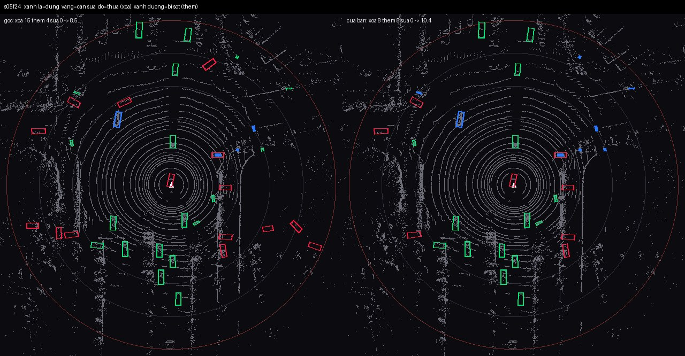

# Báo cáo Day 14 — Ngô Ngọc Trường — 2A202603329

- Mã học viên dùng với `--student`: `329`
- `seed_tag` trong `frames_A.txt`: `82ac3100fd`

## 1. Dự đoán trước sweep (bước 5b)

Tập A gồm 3 frame `s02f13`, `s03f11`, `s05f24`. Cấu hình gốc của model trên tập A, đo với `ref_A.json` đã sửa tay trên CVAT:

| Frame | Dự đoán | Xóa | Thêm | Sửa | Chi phí |
|---|---:|---:|---:|---:|---:|
| s02f13 | 29 | 13 | 4 | 0 | 7.9 |
| s03f11 | 25 | 10 | 1 | 2 | 5.0 |
| s05f24 | 34 | 15 | 4 | 0 | 8.5 |
| **Tổng** | **88** | **38** | **9** | **2** | **21.4** |

- Tham số tôi nghĩ giảm công sửa nhiều nhất: **`score_thr` tăng lên khoảng 0.4**, kết hợp **`min_points` khoảng 5–10**.
- Vì sao:
  - Box thừa nhiều hơn hẳn box sót: 38 box phải xóa, 9 box phải thêm. Công xóa (38 × 0.3 = 11.4) lớn hơn công thêm (9 × 1.0 = 9.0).
  - Xem ảnh BEV và camera của tập A, box thừa chủ yếu là Car đặt lên xe máy, xe đạp đỗ trên vỉa hè (s02f13, s05f24), lên bụi cây, hàng rào, tường quây công trường (s03f11), và 3 box ngay tâm LiDAR, tức là chính xe ghi dữ liệu. Phần lớn các box này có score thấp (khoảng 0.2–0.4), trong khi xe thật ở gần có score trên 0.8.
  - Tôi không đẩy ngưỡng lên quá cao, vì thêm 1 box sót tốn 1.0, gấp hơn 3 lần xóa 1 box thừa (0.3). Tôi đoán ngưỡng từ 0.5 trở lên sẽ bỏ cả xe thật ở xa hoặc bị che (score thấp), làm số box phải thêm tăng và tổng chi phí tăng lại.
  - `min_points` nhỏ (5–10) bỏ được vài box gần như không có điểm LiDAR (ví dụ box Car chỉ có 1 điểm) mà ít khi mất xe thật. Đặt `min_points` lớn sẽ mất xe ở xa, vốn thưa điểm.
  - Tôi đoán tune sẽ **không** giải quyết được 9 box sót (người đi bộ, người đi xe máy, xe MPV bị che) và lỗi lớp (model KITTI không có Truck/Bus, nên xe van chở hàng và xe tải nhỏ ở s03f11 vẫn ra Car). Vì vậy chi phí sau tune vẫn còn khá lớn.

## 2. Tập A: sửa tay và tune

Khi sửa tay tập A trên CVAT, tôi xóa box thừa (xe hai bánh đỗ không người lái, bụi cây, hàng rào, box tại tâm LiDAR), thêm vật bị sót (Cyclist, Pedestrian, 1 Car MPV), đổi lớp Car → Truck cho xe van chở hàng và xe tải nhỏ ở s03f11, đổi Car → Cyclist cho người lái xe máy điện ở s05f24, và bật `occluded` cho các vật bị xe khác hoặc hàng rào che một phần, theo `docs/GUIDELINE.md`.

| Cấu hình | Xóa | Thêm | Sửa | Chi phí |
|---|---:|---:|---:|---:|
| Gốc (`score_thr=0.1`, `min_points=0`) | 38 | 9 | 2 | 21.4 |
| `best_config.json` (`score_thr=0.4`, `min_points=0`) | 16 | 13 | 2 | 18.8 |

Sweep 15 cấu hình (`score_thr` ∈ {0.1…0.5} × `min_points` ∈ {0, 5, 10}). Chi phí theo từng frame của vài cấu hình tiêu biểu (trích `sweep.csv`):

| Cấu hình | s02f13 | s03f11 | s05f24 | Tổng |
|---|---:|---:|---:|---:|
| Gốc 0.1 / 0 | 7.9 | 5.0 | 8.5 | 21.4 |
| 0.2 / 5 | 7.6 | 4.7 | 7.9 | 20.2 |
| 0.3 / 5 | 7.6 | 3.5 | 9.3 | 20.4 |
| **0.4 / 0** | **6.1** | **2.3** | **10.4** | **18.8** |
| 0.5 / 0 | 5.5 | 5.5 | 12.9 | 23.9 |

- Tham số đã đổi trong `best_config.json`: chỉ `score_thr` từ 0.1 lên **0.4**. `min_points` giữ 0, vì ở ngưỡng 0.4, đặt `min_points` 5 hay 10 cho cùng kết quả (các box ít điểm đã bị ngưỡng score loại trước). Các tham số nhóm A (`voxel_size=0.16`, `passes=4`) giữ nguyên.
- Kết quả leave-one-out:
  ```
  s02f13: cấu hình chọn {'score_thr': '0.1', 'min_points': '5'} → 7.6 (tốt nhất có thể 5.5)
  s03f11: cấu hình chọn {'score_thr': '0.1', 'min_points': '5'} → 4.7 (tốt nhất có thể 2.3)
  s05f24: cấu hình chọn {'score_thr': '0.4', 'min_points': '0'} → 10.4 (tốt nhất có thể 7.9)
  ```
- Cấu hình có ổn định trên từng frame không? **Không.**
  - Ngưỡng 0.4 giảm mạnh ở s02f13 (7.9 → 6.1) và s03f11 (5.0 → 2.3), vì bỏ được nhiều box thừa score thấp trên xe đỗ, bụi cây, hàng rào (xóa 38 → 16). Nhưng nó làm **s05f24 tệ hơn** (8.5 → 10.4): frame này có nhiều người đi xe máy, người đi bộ ở xa với score thấp, nên ngưỡng 0.4 bỏ cả vật thật (thêm 9 → 13).
  - Leave-one-out xác nhận điều đó: cấu hình chọn trên 2 frame thay đổi theo frame bị bỏ ra (0.1/5 hoặc 0.4/0), và lần nào cũng kém mức tốt nhất của frame kiểm tra 2.1–2.5 điểm. Cộng 3 lần chấm được 7.6 + 4.7 + 10.4 = 22.7, còn cao hơn cấu hình gốc (21.4). Nghĩa là trên 3 frame này, lợi ích của tune chưa chắc lặp lại được trên frame mới.
  - Cấu hình `0.2 / min_points=5` giảm ít hơn (20.2) nhưng là cấu hình duy nhất tốt hơn gốc trên **cả 3 frame**, nên an toàn hơn.
  - Tôi vẫn chọn **0.4** vì đây là cấu hình có tổng chi phí thấp nhất trên tập A và giảm số box phải xóa nhiều nhất. Theo nhận xét khi sửa tay, xe đỗ và cây cối là loại lỗi phổ biến ở dữ liệu VF. Rủi ro là tập B có thể có nhiều người đi xe máy hoặc đi bộ như s05f24, khi đó chi phí sẽ tăng. Tôi sẽ đối chiếu điều này ở mục 4.

## 3. Trước/sau (bước 8)



*s05f24: bên trái là cấu hình gốc (xóa 15, thêm 4 → 8.5), bên phải là `score_thr=0.4` (xóa 8, thêm 8 → 10.4). Đỏ là box thừa, xanh dương là vật bị sót.*

| Frame | Chi phí gốc | `best_config` (0.4) |
|---|---:|---:|
| s02f13 | 7.9 | 6.1 |
| s03f11 | 5.0 | 2.3 |
| s05f24 | 8.5 | 10.4 |
| **Tổng** | **21.4** | **18.8** |

- `scripts/pp_compare.py` báo **giảm 12%** công sửa trên tập A (21.4 → 18.8). Đây là đo trên chính 3 frame dùng để tune, nên con số này lạc quan. Leave-one-out ở mục 2 cho thấy trên frame chưa thấy, mức giảm có thể không còn.
- Dự đoán ở mục 1 đúng hay sai? **Đúng phần chính, sai một phần.**
  - **Đúng:** `score_thr≈0.4` là cấu hình tốt nhất. Cơ chế cũng đúng như dự đoán: số box phải xóa giảm từ 38 xuống 16 (−22 × 0.3 = −6.6), đổi lại số box phải thêm tăng từ 9 lên 13 (+4 × 1.0 = +4.0), số sửa giữ 2, nên tổng giảm 2.6. Ngưỡng 0.5 đúng là phản tác dụng: chi phí 23.9, vì thêm tăng lên 21. Tune cũng không xử lý được 9 vật bị sót ban đầu và 2 lỗi lớp Car → Truck ở s03f11 (2 box vàng trong ảnh compare của s03f11 vẫn còn).
  - **Sai:** tôi đoán `min_points` 5–10 sẽ giúp thêm, nhưng ở ngưỡng 0.4 nó không đổi gì (18.8 cho cả 0, 5, 10), vì các box ít điểm đều đã có score thấp và bị ngưỡng loại trước. Tôi cũng không lường trước việc ngưỡng 0.4 làm **một frame tệ hơn**. Ở s05f24 (ảnh trên), ngưỡng 0.4 bỏ được 7 box thừa (−2.1) nhưng làm mất 4 vật thật: người đi xe máy và người đi bộ ở xa có score dưới 0.4 (+4.0), nên frame này tăng từ 8.5 lên 10.4. Vật nhỏ, xa, thưa điểm là nơi score của model KITTI thấp nhất, và cũng là nơi ngưỡng chung gây hại nhiều nhất. Có lẽ ngưỡng theo lớp (`thr_cyc`, `thr_ped` thấp hơn `thr_car`) sẽ hợp lý hơn một ngưỡng chung.

## 4. Tập B

Số đo từ `scripts/pp_prelabel.py --frames d14_329/frames_B.txt --config d14_329/best_config.json --gt d14_329/ref_B.json` (12 frame, `ref_B.json` gồm 169 box sau khi sửa tay trên CVAT, 168 box trong vòng 50 m):

| Xóa | Thêm | Sửa | Chi phí |
|---:|---:|---:|---:|
| 70 | 27 | 8 | 52.0 |

Chi phí theo frame:

| Frame | Dự đoán | Xóa | Thêm | Sửa | Chi phí |
|---|---:|---:|---:|---:|---:|
| s01f07 | 17 | 4 | 2 | 2 | 4.2 |
| s01f30 | 19 | 12 | 1 | 0 | 4.6 |
| s01f52 | 21 | 7 | 1 | 2 | 4.1 |
| s03f03 | 12 | 0 | 3 | 2 | 4.0 |
| s03f23 | 18 | 8 | 0 | 0 | 2.4 |
| s03f59 | 19 | 9 | 2 | 0 | 4.7 |
| s04f03 | 19 | 2 | 4 | 1 | 5.1 |
| s04f35 | 13 | 2 | 1 | 0 | 1.6 |
| s04f59 | 10 | 1 | 4 | 0 | 4.3 |
| s05f03 | 24 | 7 | 3 | 0 | 5.1 |
| s05f31 | 23 | 7 | 1 | 0 | 3.1 |
| s05f46 | 16 | 11 | 5 | 1 | 8.8 |

Phân rã theo lớp (box trong 50 m):

| Loại lỗi | Theo lớp | Công |
|---|---|---:|
| Xóa 70 box thừa | Cyclist 36, Car 32, Pedestrian 2 | 21.0 |
| Thêm 27 vật bị sót | Cyclist 10, Car 6, Pedestrian 5, Truck 4, Bus 2 | 27.0 |
| Sửa 8 box | Cyclist → Pedestrian 5, Car → Truck 3 | 4.0 |

- Loại box tốn công sửa nhất ở tập B: **Cyclist**, khoảng 23 điểm, gần một nửa tổng chi phí:
  - 36 box Cyclist giả phải xóa (10.8). Model đặt Cyclist lên bụi cây, gốc cây, hàng rào cây xanh, chữ trên tường. Nhiều box có score 0.4–0.5, sát ngưỡng `score_thr=0.4` đã chọn (44/70 box xóa có score dưới 0.5).
  - 10 người đi xe đạp hoặc xe máy bị sót phải thêm (10.0).
  - 5 box Cyclist thực ra là người đi bộ, người ngồi hoặc người vác đồ (2.5).
- Lỗi đắt thứ hai là **thêm vật bị sót (27 điểm, lớn hơn tổng công xóa 21 điểm)**. Ngoài người đi xe và người đi bộ, có 6 xe lớn hoàn toàn không được phát hiện: 4 Truck (gồm 1 xe ben xanh chỉ cách 11 m ở s05f03) và 2 Bus. Model KITTI không có lớp Truck/Bus, nên với xe lớn nó hoặc bỏ sót, hoặc gán thành Car (3 box Car → Truck).
- Đối chiếu với rủi ro đã nêu ở mục 2–3: đúng như s05f24 ở tập A, ngưỡng 0.4 làm sót nhiều người đi xe máy và đi bộ ở tập B. Chi phí trung bình mỗi frame ở B là 52.0 / 12 ≈ 4.3, thấp hơn mức 18.8 / 3 ≈ 6.3 của tập A với cùng cấu hình, nhưng cơ cấu lỗi khác: tập A chủ yếu là box xóa, tập B có phần thêm lớn hơn phần xóa.
- Frame tốn nhất là **s05f46 (8.8)**: một ngã tư có tường chữ, bồn hoa, xe tải xanh và xe van đi ngay phía trước. Model vừa đặt nhiều Cyclist giả trên tường và bồn hoa (11 box xóa), vừa sót xe van, xe tải và người đi xe máy (5 box thêm).

## 5. Giới hạn

- **Chỉ tune trên 3 frame.** Cấu hình chọn trên tập A dễ overfit với đặc điểm riêng của 3 frame này (nhiều xe đỗ, hàng rào cây). Tập B có thể có kiểu cảnh khác.
- **Model huấn luyện trên KITTI.** Model chỉ có 3 lớp Car/Pedestrian/Cyclist, không biết Truck/Bus và chưa thấy loại xe máy, xe đạp điện phổ biến ở dữ liệu VF. Lỗi lớp và box sót không sửa được bằng tune ngưỡng.
- **Chi phí là công thức, không phải thời gian thật.** `0.3·xóa + 1.0·thêm + 0.5·sửa` là trọng số quy ước. Thời gian sửa thật còn phụ thuộc độ khó từng box (vật bị che, thưa điểm) và thao tác trên CVAT. Không nên quy đổi trực tiếp sang giờ công.
- **Nhãn tham chiếu do một người sửa.** `ref_A.json` là nhãn của chính tôi, có thể còn sai kích thước, sót vật thưa điểm hoặc khó nhìn (ví dụ người đứng sau hàng rào ở s02f13).
- **Vật bị che và xe lớn phải nội suy.** Ở tập B, xe tải và xe buýt chỉ thấy một mặt trong LiDAR. Tôi đặt kích thước theo bảng 4.3 của guideline và kéo dài về phía khuất, nên vị trí và chiều dài các box này có sai số lớn hơn box xe con.
- **Ranh giới 50 m nhạy.** Hai xe buýt đỗ ở s05f24 có tâm sát mép 50 m. Chỉ cần chỉnh hộp làm tâm lệch vài chục cm là chúng ra khỏi vùng chấm, khiến chi phí cấu hình gốc đổi từ 23.4 xuống 21.4 (UNCERTAIN_SCOPE).
